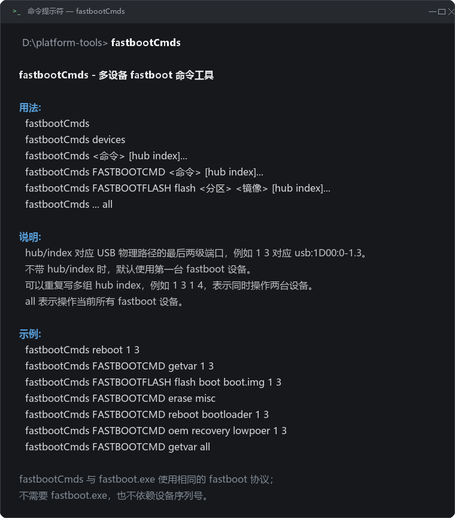

# fastbootCmds

[](https://github.com/jwl2626/fastbootCmds/actions/workflows/build.yml)
[](LICENSE)

Windows 下按 **USB 物理端口（hub/index）** 对一台或多台 Android fastboot 设备执行命令的命令行工具。

不依赖 `fastboot.exe`，直接通过 **WinUSB** 与设备的 fastboot 接口通信，因此**没有写 SN 的设备也能精确区分**——同一个 Hub 上插多台样机，可以分别刷写、互不干扰。

## 为什么不用 `fastboot.exe`

Windows 上原版 `fastboot.exe` 的 `device_path` 是空的，`fastboot -s usb:1D00:0-1.3 ...` 这种按物理端口指定设备的写法不可用；多设备并行时只能靠 SN 区分，而产线上大量设备 SN 相同或根本没有 SN。

| | `fastboot.exe` | `fastbootCmds` |
| --- | --- | --- |
| 选择设备 | `-s <SN>` | `hub index`（USB 物理端口） |
| 无 SN 设备 | 无法区分 | 可区分 |
| 多设备 | 开多个窗口 / 脚本串行 | 一条命令，多线程并行 |
| 依赖 | 自身 | 仅需 WinUSB 驱动 |

## 快速开始

```bat
:: 1. 获取 exe：从 Releases 下载，或自行编译（见「构建」）
:: 2. 放到任意 PATH 目录，例如 D:\platform-tools
:: 3. 确认能看到设备
fastbootCmds devices
```

设备必须使用 **WinUSB** 驱动（安装 Google USB Driver 或厂商 fastboot 驱动）。如果 `fastbootCmds devices` 看不到设备、但 `fastboot.exe devices` 能看到，多半是驱动或接口类型问题。



## 目录

- [1. 命令格式](#1-命令格式)
- [2. 支持的命令](#2-支持的命令)
- [3. 放置与运行](#3-放置与运行)
- [4. 和-fastbootexe-的关系](#4-和-fastbootexe-的关系)
- [5. 构建](#5-构建)
- [6. 当前限制](#6-当前限制)
- [7. 验证状态](#7-验证状态)
- [8. 开发与调试](#8-开发与调试)

---

## 1. 命令格式

```text
fastbootCmds
fastbootCmds devices
fastbootCmds <命令> [hub index]...
fastbootCmds FASTBOOTCMD <命令> [hub index]...
fastbootCmds FASTBOOTFLASH flash <分区> <镜像> [hub index]...
fastbootCmds ... all
```

- `hub index`：USB 路径的最后两级端口。例如 `1 3` 对应 `usb:1D00:0-1.3`。
- 不写 `hub index`：默认使用**第一台** fastboot 设备，等价于原版 `fastboot` 的单设备行为。
- 可以写多组：`1 3 1 4` 表示同时操作两台设备。
- `all`：操作当前所有 fastboot 设备。
- `FASTBOOTCMD` / `FASTBOOTFLASH` 是可选前缀，大小写不敏感。

### 示例

```bat
fastbootCmds
fastbootCmds reboot 1 3
fastbootCmds FASTBOOTCMD getvar 1 3
fastbootCmds FASTBOOTFLASH flash boot boot.img 1 3
fastbootCmds FASTBOOTCMD erase misc
fastbootCmds FASTBOOTCMD reboot bootloader 1 3
fastbootCmds FASTBOOTCMD oem recovery lowpoer 1 3
```

多设备：

```bat
fastbootCmds FASTBOOTCMD reboot 1 3 1 4
fastbootCmds FASTBOOTFLASH flash boot boot.img 1 3 1 4
fastbootCmds FASTBOOTCMD getvar all
```

只查看设备：

```bat
fastbootCmds devices
```

---

## 2. 支持的命令

| 命令 | 说明 |
| --- | --- |
| `reboot [system\|bootloader\|fastboot\|recovery\|edl]` | 重启 |
| `getvar [变量名]` | 不带变量名时执行 `getvar all` |
| `erase <分区>` | 擦除 |
| `flash <分区> <镜像>` | 刷写（raw / sparse，见限制） |
| `oem <参数...>` | OEM 命令，例如 `oem recovery lowpoer` |
| `flashing unlock\|lock\|...` | 解锁/上锁 |
| `set_active <slot>` | 切换 slot |
| `boot <镜像>` | 临时启动 |
| `continue` | 继续启动 |
| `raw <fastboot 命令>` | 透传任意命令 |
| 其他 | 原样作为 fastboot 命令发送 |

---

## 3. 放置与运行

`fastbootCmds.exe` 是 **64 位** 程序，把编译好的 exe 放到 PATH 中的任意目录即可，例如：

```text
D:\platform-tools\fastbootCmds.exe
```

然后：

```bat
cd /d D:\platform-tools
fastbootCmds
fastbootCmds devices
fastbootCmds FASTBOOTCMD getvar 1 3
```

不需要 `fastboot.exe` 在旁边；但需要设备使用 **WinUSB** 驱动（安装 Google USB Driver 或厂商 fastboot 驱动）。

---

## 4. 和 `fastboot.exe` 的关系

- `fastboot.exe` 单设备、默认第一台、用 `-s SN` 选择设备。
- `fastbootCmds.exe` 用 `hub index` 选择设备，并支持多设备；命令语义保持一致。
- `fastbootCmds.exe` 不解析 `fastboot.exe` 的 `-s`，也不需要序列号。
- 因为 Windows 原版 `fastboot.exe` 的 `device_path` 是空的，`fastboot -s usb:...` 在 Windows 上不可用；本工具直接走 WinUSB，所以不受这个限制。

---

## 5. 构建

源码在 `src/`。使用 64 位 MinGW-w64：

```bat
build.bat
```

### 用 VS Code 编译

1. 用 VS Code 打开本仓库根目录。
2. 安装扩展 **C/C++**（`ms-vscode.cpptools`，打开文件夹时会推荐）。
3. 按 `Ctrl+Shift+B`，选择：
   ```text
   build (release)
   ```
   或菜单 **Terminal → Run Build Task**。
4. 生成 `fastbootCmds.exe`，再复制到 PATH 目录。
5. 调试按 `F5`，使用 `.vscode/launch.json` 里的 `Debug fastbootCmds.exe`。

`.vscode/tasks.json` 里默认配置为 `D:/mingw64/bin/g++.exe`、头文件路径和全部链接库。  
如果你的 MinGW 不在 `D:\mingw64`，改 `tasks.json`、`c_cpp_properties.json`、`launch.json` 里的路径即可。

如果 `-Werror` 因为编译器版本报警告，使用任务：

```text
build (no Werror)
```

或手工：

```bat
g++ -std=c++17 -O2 -Wall -Wextra -Werror -Isrc ^
  src\main.cpp src\winusb_fastboot.cpp src\fastboot_client.cpp src\usb_path_windows.cpp ^
  -lsetupapi -lcfgmgr32 -lwinusb -lshell32 ^
  -static -static-libgcc -static-libstdc++ -o fastbootCmds.exe
```

---

## 6. 当前限制

- `flash` 支持：
  - 小于等于 `max-download-size` 的 raw 镜像；
  - 小于等于 `max-download-size` 的 sparse 镜像；
  - AVB footer 自动移动到分区末尾（原始 boot 镜像小于分区时）。
- 超过 `max-download-size` 的镜像暂不支持自动 sparse 分片，会报错；先用 `fastboot.exe` 或后续版本。
- 依赖设备驱动为 WinUSB；如果 `fastbootCmds devices` 看不到设备，但 `fastboot.exe devices` 能看到，多半是驱动/接口类型问题。
- 多设备操作时每个设备一个线程，输出最后按设备分组打印。
- 没有实现 `format` / `update` / `flashall` / 动态分区管理。
- 只在 Windows 上验证；未在真机 fastboot 上验证刷写（开发机无设备）。

---

## 7. 验证状态

- 64 位 MinGW g++ 编译通过（`-Wall -Wextra -Werror`）。
- `fastbootCmds` 无参数时正确打印用法。
- `fastbootCmds devices` 在无设备时返回明确错误。
- USB 路径 helper 在真实 USB 设备上解析出 `usb:1D00:0-1.3` 等路径。
- **尚未在真机 fastboot 上验证 `getvar` / `flash`**，欢迎反馈实际机型与结果。

---

## 8. 开发与调试

仓库自带 VS Code 配置（`.vscode/tasks.json`、`launch.json`），不用手写 JSON：

| 入口 | 说明 |
| --- | --- |
| `Ctrl+Shift+B` | 构建 `build (release)` |
| `F5` → ① ② ③ | 源码级调试（断点、变量、调用栈），③ 的 `args` 可改成任意命令 |
| `F5` → ④ | 直接调试现成的 `fastbootCmds.exe`，不重新编译 |
| `F5` → ⑤ | 附加到运行中的进程（界面调起它时用） |
| `F5` → ⑥ | 调试 PySide6 调试界面本身 |

调试构建输出 `fastbootCmds_dbg.exe`（`-O0 -g3`），不会覆盖发布用的 `fastbootCmds.exe`。

**界面调试台**（PySide6，`tools/fastboot_gui.py`，只用标准库 + PySide6）：

```bat
python tools\fastboot_gui.py
```

选命令、填 `hub index`、挑镜像文件，点「运行」即可看到完整 argv、实时输出、退出码、耗时和**子进程 PID**——PID 可以直接拿到 VS Code 里 attach。

完整说明（含断点位置建议、快捷键、排错表）见 **[docs/DEBUGGING.md](docs/DEBUGGING.md)**。

---

## License

[MIT](LICENSE)
