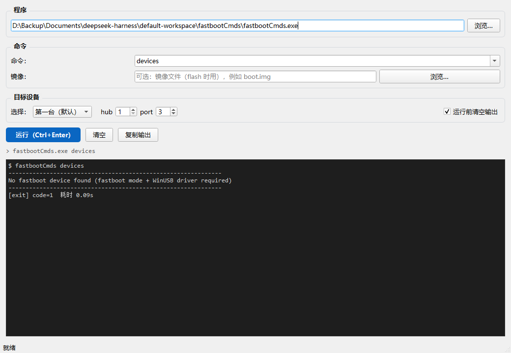

# 在 VS Code 里编译与调试 fastbootCmds

本文对应仓库里的 `.vscode/tasks.json` 与 `.vscode/launch.json`。两条调试路线是分开的：

| | 路线 A：源码级调试 | 路线 B：黑盒调试 |
| --- | --- | --- |
| 对象 | 你自己编译的 `fastbootCmds_dbg.exe` | 已经编好的 `fastbootCmds.exe` |
| 能看到 | 断点、变量、调用栈、单步 | 只有输入输出、退出码 |
| 适合 | 改代码、查逻辑错误 | 验证成品行为、复现现场问题 |
| 入口 | `F5` → ① / ② / ③ | `F5` → ④，或界面 + ⑤ 附加 |

---

## 1. 准备

**扩展**（装一次）：

- **C/C++**（`ms-vscode.cpptools`）—— 提供 `cppdbg` 调试器
- **Python**（`ms-python.python`）—— 调试 PySide6 界面时用

**工具链**（本机已就绪）：

```text
D:\mingw64\bin\g++.exe    编译器
D:\mingw64\bin\gdb.exe    调试器
```

**打开方式**：`文件 → 打开文件夹`，选 `fastbootCmds` 根目录，不要只打开单个 .cpp 文件，否则 `.vscode` 配置不生效。

---

## 2. 编译：三个任务

`Ctrl+Shift+B` 直接跑默认任务 `build (release)`；要跑别的用 `终端 → 运行任务…`（`Ctrl+Shift+P` → `Tasks: Run Task`）。

| 任务 | 关键参数 | 产物 | 用途 |
| --- | --- | --- | --- |
| `build (release)` | `-O2 -g -Werror` | `fastbootCmds.exe` | 发布、日常验证 |
| `build (debug)` | `-O0 -g3 -ggdb` | `fastbootCmds_dbg.exe` | **调试专用** |
| `build (no Werror)` | `-O0 -g` | `fastbootCmds.exe` | 编译器版本差异导致警告变错误时救急 |

**两个要点：**

1. **调试必须用 `-O0`**。`-O2` 会把变量优化掉、把语句重排，断点会“跳行”，变量显示 `<optimized out>`，调试体验很差。所以 `build (debug)` 特意用了 `-O0 -g3`。
2. **调试产物单独命名** `fastbootCmds_dbg.exe`，这样 F5 反复编译也不会覆盖你准备发布/复制到 `platform-tools` 的那个 exe。

---

## 3. 路线 A：源码级调试

`F5` 后从下拉里选配置：

| 配置 | 做什么 |
| --- | --- |
| ① 调试源码 · 无参数 | 停在 `PrintUsage()` 前的执行流，观察“没给参数”的分支 |
| ② 调试源码 · devices | 走设备枚举路径，适合查 `EnumerateFastbootDevices` |
| ③ 调试源码 · 自定义参数 | 默认 `["getvar","1","3"]`，**改这个数组就能调任何子命令** |

③ 的 `args` 是数组，一个元素一个参数，不要写成 `"getvar 1 3"`（那会是一个含空格的参数）：

```json
"args": ["flash", "boot", "D:/images/boot.img", "1", "3"]
```

启动后：

- 代码行左侧点一下 = **红点断点**（F9 也可）
- 命中后左侧面板看 **变量 / 监视 / 调用堆栈**
- 顶部小工具条：继续、单步跳过（F10）、单步进入（F11）、跳出（Shift+F11）、重启、停止（Shift+F5）

**推荐的断点位置**（都在 `src/main.cpp`）：

| 行 | 位置 | 看什么 |
| --- | --- | --- |
| 321 | `help` 分支 | `first` 的取值 |
| 325 | `devices` 分支 | 进入枚举前 |
| 344 | `ParseCommand` 调用 | `raw`、`command`、`targets` 的解析结果 |
| 357 | `SelectDevices` 调用 | 设备选择是否命中 |

> 小技巧：断点别打在函数**第一行**。函数序言还没执行，参数/局部变量是栈上的垃圾值（看起来像 `argc = 336003091`）。往下走一行就正常了。

进阶用法：

- **条件断点**：右键断点 → 编辑断点 → 条件 `i == 3`
- **日志断点**：右键 → 编辑断点 → 日志消息，打印后自动继续，不打断运行
- **调试控制台**（`Ctrl+Shift+Y`）：直接执行 `print command`、`p targets.size()`、甚至 `call PrintUsage()`

---

## 4. 路线 B：黑盒调试（对着已编译的 exe）

**④ 调试现成的 exe**：不重新编译，直接拉起 `${workspaceFolder}/fastbootCmds.exe`。

- 如果这个 exe 是 `build (release)` 产出的，它带 `-g`，仍能下断点，但因为 `-O2`，变量可能不准；
- 如果是别处拷来的、完全没符号的 exe，你只能看到反汇编，断点也只能按地址下。

**⑤ 附加到运行中的进程**：程序已经在跑（比如界面调起的），`F5` → ⑤ → 在进程列表里选 `fastbootCmds.exe` → 附加后可以下断点。

> **必须说清楚的一点**：`fastbootCmds devices` 在没有设备时 **0.08 秒就退出**，根本来不及附加。attach 只对**长命令**有意义，比如 `flash` 一个大镜像时的下载/写入阶段。想在界面里“边点边断点”，更现实的做法是：界面里确认好参数 → 把 argv 抄到 ③ 里 → 用 F5 单步。

---

## 5. 路线 C：界面调试台（PySide6）

```bash
python tools\fastboot_gui.py
```



界面把命令行参数可视化：选命令、选 `hub index`、挑镜像文件，点“运行”就能看到完整 argv、实时输出、退出码、耗时和**子进程 PID**。

调试界面本身：`F5` → ⑥，就能在 `fastboot_gui.py` 里下 Python 断点（比如 `run_command`、`_on_finished`），观察 QProcess 的启动与信号。

**组合玩法（界面 + C++ 断点）**：

1. 界面里跑一条耗时命令（例如 `flash` 大镜像）；
2. 从输出里复制 `[pid] xxxx`；
3. VS Code `F5` → ⑤ → 选那个进程；
4. 在 `fastboot_client.cpp` 的发送/接收循环里下断点。

---

## 6. 快捷键

| 键 | 作用 |
| --- | --- |
| `Ctrl+Shift+B` | 构建（默认 release） |
| `F5` | 启动调试 / 继续 |
| `F9` | 切换断点 |
| `F10` | 单步跳过 |
| `F11` | 单步进入 |
| `Shift+F11` | 跳出函数 |
| `Shift+F5` | 停止调试 |
| `Ctrl+Shift+Y` | 调试控制台 |
| `Ctrl+Shift+P` → `Tasks: Run Task` | 选任意构建任务 |

---

## 7. 常见问题

| 现象 | 原因与处理 |
| --- | --- |
| 断点是**空心灰圈**，悬停提示 “No symbols” | 用了 release exe 或没带 `-g`。用 `build (debug)`，并确认 F5 选的是 ①/②/③ |
| 变量显示 `<optimized out>` | `-O2` 优化掉了。换 `-O0` 的 debug 构建 |
| `Unable to start debugging. Unable to establish a connection to GDB` | `miDebuggerPath` 不对。确认 `D:\mingw64\bin\gdb.exe` 存在；换了 MinGW 目录就同步改 `launch.json` |
| 程序一闪而过，看不到输出 | `externalConsole: true` 会弹独立窗口；或先在 `main` 下个断点 |
| 断点停在函数第一行，参数是乱值 | 序言未执行，往下单步一行再看 |
| gdb 刷 `Python Exception ... Invalid length` | 通常是打印了未初始化的对象；在函数体内部断点可避免 |
| PowerShell 里 `gdb -ex "..."` 报 `Excess command line arguments` | PS 会把带空格的参数拆开，改用 `-x script.gdb` |
| 中文显示成乱码 | 程序输出是 UTF-8；gdb/终端需 UTF-8（本程序 `main` 里已 `SetConsoleOutputCP(CP_UTF8)`） |

---

## 8. 不开 VS Code 也能验证断点

```bash
gdb --batch -x .vscode\selftest.gdb
```

`.vscode/selftest.gdb` 会在 `main.cpp:344` 停下并打印 `raw` / `command` / `targets`，用来确认“符号表 + gdb + 断点”这条链是通的。

---

## 9. 建议的练习顺序

1. **无参数**：F5 → ①，在 `PrintUsage()` 前停住，单步看完整个用法打印流程。
2. **devices**：F5 → ②，进入 `EnumerateFastbootDevices`，看枚举失败时 `error` 里的内容怎么来的。
3. **getvar 1 3**：F5 → ③，在 `main.cpp:344` 看 `targets` 是否解析成 `[(1,3)]`。
4. **界面**：`python tools\fastboot_gui.py`，点几个预设命令，确认 argv 拼得对。
5. **组合**：界面跑一条长命令，同时用 ⑤ 附加，在 `fastboot_client.cpp` 里下断点。
